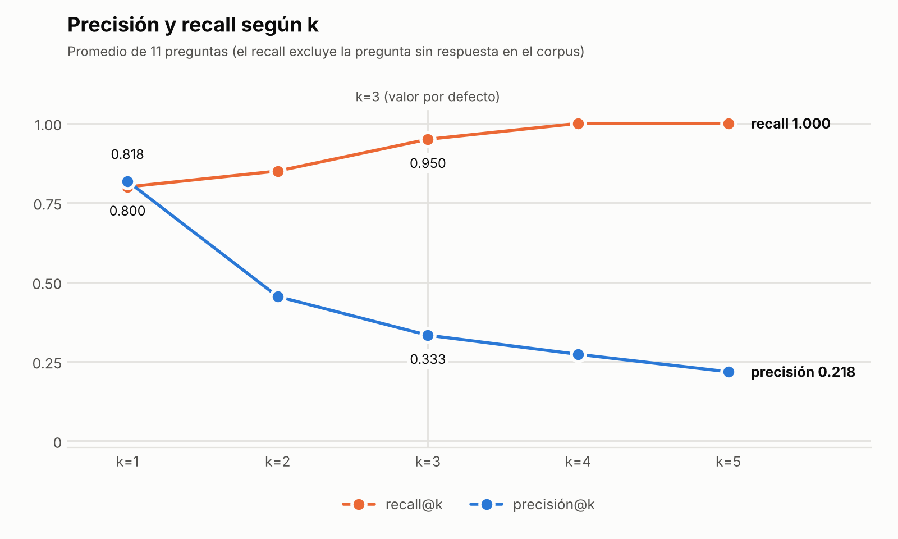

# Proyecto BDIA

Repositorio del proyecto de la especialización en IA avanzada (Skillnest / Accenture). Contiene un cliente Python para la API de Google Gemini que arma las peticiones, clasifica los errores del proveedor, reintenta automáticamente los que son momentáneos con backoff exponencial y registra el costo de cada operación. Incluye además un flujo orquestado con LangChain que clasifica cada solicitud según el alcance del servicio y, si describe un negocio, genera en tres pasos encadenados el script de creación de una base de datos PostgreSQL nueva, con respaldos ante fallos en cada ruta. Un agente con herramientas y memoria por sesión responde consultas de modelado, con aprobación humana para su única acción de riesgo alto y un registro de trazas de cada interacción. Un índice vectorial de buenas prácticas de modelado en PostgreSQL, con los documentos divididos en chunks y sus embeddings de Gemini, se guarda en Chroma. Un flujo de recuperación consulta ese índice, arma un prompt con los fragmentos más relevantes numerados y obtiene una respuesta que cita su fuente. Un conjunto de preguntas con sus fragmentos relevantes etiquetados mide la precisión y el recall de esa recuperación y guarda el registro de cada corrida. Completan el repositorio un pipeline de limpieza y tokenización de texto con métricas de precisión, cobertura y F1 para comparar las respuestas del modelo con referencias propias, una revisión manual de esas respuestas con sus límites documentados, la comparación de modelos candidatos, el registro de la decisión de arquitectura sobre el modelo utilizado y un banco de prompts de sistema con salida JSON estructurada, validado por consistencia.

## Requisitos

- Python 3.13 (probado con 3.13.0)
- Git
- Una API key de Google Gemini, creada en Google AI Studio

## Puesta en marcha

1. Clonar el repositorio y entrar a la carpeta:

```
git clone https://github.com/PauloRoa/BDIA.git
cd BDIA
```

2. Crear el entorno virtual:

```
python -m venv .venv
```

3. Activarlo (cada terminal necesita su propia activación):

Git Bash:

```
source .venv/Scripts/activate
```

PowerShell:

```
.\.venv\Scripts\Activate.ps1
```

4. Instalar las dependencias:

```
pip install -r requirements.txt
```

5. Crear el archivo de variables de entorno a partir de la plantilla:

```
cp .env.example .env
```

6. Abrir `.env` y reemplazar el marcador por tu clave real en la variable `API_KEY`. El archivo `.env` está excluido en `.gitignore` y nunca se sube al repositorio.

## Uso

Con el entorno activo, desde la raíz del repositorio:

```
python src/cliente.py
```

Envía una pregunta fija al modelo a través de `consultar_modelo`, el punto de entrada del cliente, y muestra el costo de la operación y el texto generado. Si el proveedor falla de forma momentánea, el cliente reintenta automáticamente. La respuesta varía en cada ejecución, porque proviene de un modelo generativo. Para cambiar la pregunta, se edita la llamada final del archivo.

```
python src/consumir_gemini.py
```

Envía una pregunta fija al modelo `gemini-3.1-flash-lite` (constante `MODELO`) directamente, sin reintentos, y muestra el texto generado.

```
python src/enrutamiento.py
```

Procesa tres solicitudes de ejemplo con el flujo orquestado: la descripción de un negocio, un pedido para modificar una base existente y una pregunta conceptual. Clasifica cada una y la dirige a su ruta: genera el script de creación, rechaza la solicitud por estar fuera de alcance o pide una descripción del negocio. Muestra la respuesta de cada solicitud y el registro de cada petición. Realiza 8 peticiones por ejecución: 4 para la descripción de negocio y 2 para cada una de las otras.

```
python src/cadena_tres_pasos.py
```

Genera, sin clasificación previa, el script de creación para la descripción de negocio de ejemplo (constante `DESCRIPCION_NEGOCIO`). Realiza 3 peticiones por ejecución.

```
python src/agente_con_herramientas.py
```

Ejecuta el agente con tres consultas de verificación (`VERIFICACIONES`): una que debe usar `consultar_buenas_practicas`, una que debe usar `verificar_sentencias_permitidas` y una pregunta general que no debe usar ninguna herramienta. Muestra la respuesta y las herramientas usadas en cada una, y comprueba que coincidan con lo esperado. Ninguna de las tres consultas pide guardar un borrador, por lo que no se solicita aprobación humana. El número de peticiones varía, porque el agente decide cuántas llamadas al modelo necesita.

```
python src/agente_con_memoria.py
```

Ejecuta el agente con memoria en una misma sesión (`supervision_riesgos`) con cuatro consultas: una por cada herramienta de riesgo bajo y dos de `guardar_borrador`, la herramienta de riesgo alto. En esas dos últimas, el programa se detiene y pide por consola la aprobación humana (`s` para aprobar, cualquier otra respuesta rechaza; se espera hasta 60 segundos). Cada ejecución agrega líneas a `docs/trazas_agente.jsonl` y, si se aprueba, crea archivos en `docs/borradores/`. Al terminar imprime las decisiones de aprobación registradas. Como `docs/trazas_agente.jsonl` está versionado como evidencia, cada ejecución lo modifica; para conservar la evidencia original se puede restaurar con `git restore docs/trazas_agente.jsonl`.

```
python src/indexar_corpus.py
```

Lee los documentos `.md` de `corpus/`, los divide en chunks de hasta 500 caracteres con un traslape de 75, calcula un embedding por chunk con `models/gemini-embedding-001` (consume tokens) y los guarda en `vectorstore/`. Al terminar se reconecta al índice guardado y muestra cuántos chunks contiene. Con el corpus actual son 14 chunks de 7 documentos. Si se vuelve a ejecutar, actualiza los chunks que ya existían sin duplicarlos, elimina los que ya no corresponden al corpus y calcula de nuevo los embeddings de todos los chunks. Si falla, muestra el motivo, termina con código 1 y no modifica el índice anterior.

```
python src/recuperacion.py
```

Hace tres preguntas de ejemplo (`PREGUNTAS_DE_PRUEBA`): dos que el corpus responde y una de PostgreSQL que no está en él. Para cada una recupera los 3 chunks más parecidos del índice guardado en `vectorstore/`, arma el prompt con el contexto numerado, lo envía al modelo con `consultar_modelo` y muestra las fuentes recuperadas, la respuesta y la fuente de cada cita. Requiere haber ejecutado antes `python src/indexar_corpus.py`. Realiza 3 cálculos de embeddings y 3 peticiones al modelo por ejecución, sin contar reintentos, y muestra el costo de cada operación del modelo. Si falla, muestra el tipo de la excepción y su detalle técnico, y termina con código 1.

```
python src/evaluacion_recuperacion.py
```

Evalúa la recuperación con 11 preguntas (`CASOS_EVALUACION`): 10 con sus chunks relevantes etiquetados y una que el corpus no puede responder. Antes de consultar comprueba que los ids relevantes existan en el índice. Para cada pregunta recupera del índice guardado en `vectorstore/` los k chunks más parecidos, con k igual a `K_POR_DEFECTO` (3), y calcula la precisión y el recall. Muestra cada pregunta con sus ids relevantes y recuperados, y los promedios, y guarda el registro en `docs/resultados_evaluacion_<fecha>_k<k>.txt`. Un argumento permite evaluar otro k:

```
python src/evaluacion_recuperacion.py 5
```

Requiere haber ejecutado antes `python src/indexar_corpus.py`. Realiza 11 cálculos de embeddings por ejecución y ninguna llamada de generación. Si se repite el mismo día con el mismo k, sobrescribe el archivo. Si falla, muestra el tipo de la excepción y su detalle técnico, y termina con código 1.

Scripts complementarios, que se ejecutan de la misma forma:

```
python src/evaluar_salidas.py
```

Envía 20 preguntas de modelado de datos y PostgreSQL al modelo a través del cliente, con una pausa de 2 segundos entre llamadas, calcula la precisión, la cobertura y el F1 de cada respuesta frente a una referencia propia y guarda caso, consulta, referencia, respuesta y métricas en `docs/resultados_metricas.json`. Muestra además los promedios y la muestra para revisar a mano: los 5 casos con menor F1 y los 5 con mayor F1. Realiza 20 peticiones por ejecución.

```
python src/revision_manual.py
```

Guarda en `docs/revision_manual.json` la revisión manual de esa muestra: por cada caso, la calificación de corrección factual, completitud y contradicción, con una nota que la justifica. No realiza peticiones. Los límites de la métrica que se desprenden de esta revisión están en `docs/limites_metrica.md`.

```
python src/pipeline_texto.py
```

Envía las tres primeras preguntas, compara cada respuesta con su referencia por coincidencia de palabras, sobre texto crudo y sobre texto procesado, y guarda el resultado en `docs/registro_pipeline_texto.md`. Realiza 3 peticiones por ejecución.

```
python src/contar_tokens.py
```

Envía una pregunta fija y muestra los tokens de entrada y de salida de la petición, junto con su costo en dólares, calculado con los precios de `gemini-3.1-flash-lite`.

```
python src/comparar_modelos.py
```

Compara dos modelos candidatos (`gemini-3.5-flash-lite` y `gemini-3.1-flash-lite`): repite cuatro veces una misma pregunta para medir latencia y costo, y envía una segunda pregunta para evaluar la calidad de la respuesta. Realiza 10 peticiones por ejecución. El análisis y la decisión se registran en `docs/decision-arquitectura.md`.

```
python prompts/test_consistencia.py
```

Ejecuta tres veces cada prompt del banco (`prompts/banco.py`), valida que la respuesta sea un JSON con las claves esperadas y guarda el resultado en `prompts/registro_resultados.json`. Realiza 9 peticiones por ejecución.

## Pruebas

Las pruebas unitarias están en `tests/`:

- `test_cliente.py`: el cliente.
- `test_pipeline_texto.py`: el pipeline de texto, sus métricas y dos de los límites documentados en `docs/limites_metrica.md`.
- `test_cadena_tres_pasos.py`: que la cadena de tres pasos haga tres llamadas, que cada paso reciba la salida del anterior y que una entrada con una clave equivocada falle antes de llamar al modelo.
- `test_enrutamiento.py`: la normalización de la clasificación y cada una de las rutas, incluida la ruta por defecto.
- `test_orquestacion.py`: los respaldos de las rutas, la respuesta segura ante fallos fuera de las rutas, incluido el error de configuración, y las entradas vacías o que no son texto.
- `test_agente.py`: las herramientas del agente, la aprobación humana (solo `s` aprueba; la falta de entrada y el tiempo agotado rechazan), el guardado de borradores aprobado, rechazado y con entradas no válidas, el historial separado por sesión, el registro de trazas y que un fallo al registrar la traza no impida entregar la respuesta.
- `test_indexar_corpus.py`: la carga del corpus, la división en chunks, los ids estables, el guardado en el índice y la eliminación de los chunks sobrantes, que un fallo de la API no toque el índice anterior, la reconexión sin recalcular embeddings y la construcción de los embeddings con la clave.
- `test_recuperacion.py`: el contexto numerado y sus fuentes, que el prompt conserve la pregunta exacta y traiga las instrucciones de citar, el valor de k, que la recuperación se reconecte al índice sin reindexar, el rechazo de preguntas vacías y la traducción de las citas de una respuesta, incluidas las inválidas.
- `test_evaluacion_recuperacion.py`: la precisión y el recall, incluidos la lista vacía y el caso sin ids relevantes, el promedio que ignora los `None`, la comprobación de las etiquetas, que la evaluación consulte el retriever con cada pregunta y corte a k, el formato del registro y que los casos de evaluación sean válidos y sus ids existan en el corpus.

Las pruebas del cliente simulan la API y las esperas con mocks; las del flujo orquestado y las del agente reemplazan el modelo, las rutas, la entrada por consola y la escritura de borradores por mocks o funciones falsas; las de la indexación y la recuperación reemplazan Chroma y los embeddings, y las de la evaluación reemplazan el retriever. Ninguna prueba consume tokens ni requiere conexión. Las pruebas del registro de trazas y las del guardado del registro de la evaluación escriben un archivo temporal en `tests/` que se elimina al terminar. Con el entorno activo, desde la raíz del repositorio:

```
pytest tests/ -v
```

`pytest.ini` limita la búsqueda de pruebas a `tests/`, por lo que `prompts/test_consistencia.py`, que hace peticiones reales, no se ejecuta con `pytest`.

## Cliente `src/cliente.py`

Interfaz pública para consultar el modelo. Usa las funciones de `src/consumir_gemini.py` y agrega el reintento y el registro de costo, de modo que quien lo usa no necesita conocer el orden de las llamadas ni cómo se manejan los errores por dentro. El costo se calcula con los precios de `gemini-3.1-flash-lite` (constantes `PRECIO_ENTRADA` y `PRECIO_SALIDA`) y se acumula en `costo_total_sesion`, que vuelve a cero en cada ejecución.

| Función | Responsabilidad |
|---|---|
| `consultar_modelo(pregunta, system_instruction)` | Punto de entrada único: arma la petición, la envía con reintento, registra su costo y devuelve el texto generado. `system_instruction` es opcional. Si se agotan los reintentos, lanza `RuntimeError` con un mensaje para quien usa el cliente. |
| `con_reintento(funcion, intentos, espera_base, espera_maxima)` | Ejecuta una función sin argumentos y, si lanza `TimeoutError`, muestra el motivo, espera y la vuelve a intentar. La espera se duplica en cada intento a partir de `espera_base` (backoff exponencial), nunca supera `espera_maxima` y suma hasta un 10 % aleatorio (jitter). Por defecto: 3 intentos, base de 2 segundos y máximo de 30, es decir, esperas de 2 y 4 segundos. En el último intento deja pasar el error. Cualquier otra excepción se propaga sin reintentar. |
| `registrar_costo(respuesta)` | Calcula el costo de una operación exitosa con `calcular_costo`, lo suma a `costo_total_sesion`, muestra los tokens, el costo de la operación y el acumulado, y lo devuelve. Si la respuesta no trae el conteo de tokens, avisa y registra 0, sin impedir que se entregue la respuesta. |

Ejemplo de uso desde otro archivo de `src/`:

```python
from cliente import consultar_modelo

try:
    print(consultar_modelo("¿Cuál es la capital de Chile?"))
except ValueError as error:
    print(f"Error de configuración: {error}")
except RuntimeError as error:
    print(f"El servicio no respondió tras varios intentos: {error}")
```

## Flujo orquestado `src/enrutamiento.py` y `src/cadena_tres_pasos.py`

Construido con LangChain. Las llamadas al modelo las hace `ChatGoogleGenerativeAI` (paquete `langchain-google-genai`), con el mismo modelo (`MODELO`, importado de `consumir_gemini.py`), la misma clave (`API_KEY`, que se le pasa de forma explícita) y `temperature=0`. No pasa por `cliente.py`, por lo que no muestra el costo de cada operación.

El servicio solo diseña bases de datos nuevas. Cada solicitud se clasifica primero y se dirige a una de tres rutas:

| Categoría | Cuándo | Ruta |
|---|---|---|
| `nueva` | La solicitud describe un negocio para diseñar una base nueva | Cadena de tres pasos que genera el script de creación |
| `existente` | La solicitud pide modificar, migrar o analizar una base que ya existe | Respuesta que rechaza la solicitud y explica el alcance del servicio |
| `otra` o cualquier categoría inesperada | Cualquier otra solicitud, o una respuesta del clasificador fuera de lo esperado | Respuesta que pide una descripción del negocio |

La ruta por defecto es la segura: una clasificación inesperada nunca genera un script.

La cadena de tres pasos (`construir_cadena` en `cadena_tres_pasos.py`) encadena tres prompts, y la salida de cada uno es la entrada del siguiente:

| Paso | Responsabilidad |
|---|---|
| 1. Extraer | Identifica las entidades del negocio, sus atributos y las relaciones entre ellas, sin proponer tablas. |
| 2. Modelar | Convierte esas entidades en tablas con columnas, tipos de PostgreSQL, clave primaria y claves foráneas, sin columnas que se puedan calcular a partir de otras tablas. |
| 3. Generar | Escribe el script con sentencias `CREATE TABLE`, ordenadas para que cada tabla se cree después de las tablas que referencia. |

Los prompts le indican al modelo que incluya los atributos que la descripción menciona y que, si sugiere otros habituales, los marque como supuesto: sin `NOT NULL` y con el comentario SQL `-- supuesto` después de la coma que separa esa columna de la siguiente. Como son instrucciones a un modelo generativo, el resultado puede variar entre ejecuciones. El script es un borrador sujeto a revisión humana.

| Función | Responsabilidad |
|---|---|
| `construir_cadena(modelo)` | Arma la cadena de tres pasos. Recibe el modelo como parámetro para poder reemplazarlo en las pruebas. |
| `construir_paso_clasificacion(modelo)` | Clasifica la solicitud en una palabra y la normaliza con `limpiar_texto` del pipeline de texto (minúsculas y sin puntuación) antes de compararla. |
| `construir_cadena_rechazo(modelo)` | Responde a una solicitud sobre una base existente explicando que está fuera del alcance del servicio. |
| `construir_cadena_aclaracion(modelo)` | Responde pidiendo una descripción del negocio, con un ejemplo de qué incluir. |
| `construir_cadena_con_enrutamiento(paso_clasificacion, cadena_nueva, cadena_existente, cadena_aclaracion)` | Agrega la categoría a la entrada sin perder la descripción original y ejecuta la ruta que corresponde. |
| `construir_ruta_segura(cadena, mensaje_respaldo)` | Protege una ruta: si falla, registra que se usó el respaldo y responde con un mensaje fijo propio de esa ruta. |
| `procesar_solicitud_segura(cadena, descripcion)` | Punto de entrada del flujo: si la solicitud está vacía, pide una descripción del negocio sin llamar al modelo; si no, ejecuta la cadena completa y, si algo falla fuera de las rutas, registra el error con su traceback y devuelve una respuesta segura. |
| `es_error_de_configuracion(error)` | Indica si un error corresponde a una clave inválida (motivo `API_KEY_INVALID`), para responder con el mensaje de configuración en vez del general. |

## Agente `src/agente_con_herramientas.py` y `src/agente_con_memoria.py`

Construido con LangChain (`create_tool_calling_agent` y `AgentExecutor`), con el mismo modelo, clave y `temperature=0` que el flujo orquestado. La instrucción del sistema le indica que responda en español, en no más de tres oraciones y sin formato markdown, y que use las herramientas cuando las necesite.

| Herramienta | Qué hace | Nivel de riesgo |
|---|---|---|
| `consultar_buenas_practicas(tema, incluir_ejemplo)` | Devuelve una buena práctica de modelado sobre un tema (clave primaria, clave foránea, muchos a muchos, normalización o tipo de dato), con un ejemplo si se pide. Sus argumentos se validan con un esquema Pydantic. | Bajo |
| `verificar_sentencias_permitidas(script)` | Revisa si un script usa solo `CREATE TABLE` y `CREATE INDEX`. | Bajo |
| `guardar_borrador(nombre, script)` | Guarda el script en `docs/borradores/<nombre>.sql`; si el archivo existe, lo reemplaza. Sus argumentos se validan con un esquema Pydantic. | Alto |

`guardar_borrador` requiere siempre aprobación humana, implementada dentro de la propia herramienta. Antes de pedirla, valida que el nombre solo tenga letras, números y guion bajo, que el script no esté vacío y que todas sus sentencias sean `CREATE TABLE` o `CREATE INDEX`; si no se cumple, devuelve el motivo sin pedir aprobación ni escribir nada. Si se cumple, `esperar_aprobacion` muestra el nombre del archivo, la cantidad de sentencias y si se crea o se reemplaza, y espera hasta 60 segundos (`TIEMPO_LIMITE_APROBACION`). Solo la respuesta `s` aprueba: cualquier otra respuesta, la falta de entrada o el tiempo agotado rechazan y no se escribe ningún archivo. Cada decisión se agrega a `registro_aprobaciones` y queda en la traza, porque la respuesta de la herramienta se guarda como observación. La carpeta `docs/borradores/` está excluida en `.gitignore`.

La memoria (`agente_con_memoria.py`) guarda el historial de cada sesión en un diccionario en memoria (`historiales`), identificado por `session_id`: dos sesiones no comparten historial y los historiales se pierden al terminar el programa.

| Función | Responsabilidad |
|---|---|
| `construir_agente(modelo, prompt)` | Arma el agente con sus tres herramientas. Devuelve un `AgentExecutor` que conserva los pasos intermedios. |
| `consultar_agente_seguro(ejecutor_agente, entrada)` | Consulta al agente sin memoria. Si falla, devuelve un mensaje seguro (el de configuración si la clave es inválida, o el general) y `None` en lugar de las herramientas usadas. |
| `construir_agente_con_memoria(modelo)` | Agrega al agente un historial por sesión con `RunnableWithMessageHistory`. |
| `obtener_historial(session_id)` / `cerrar_sesion(session_id)` | Crea u obtiene el historial de una sesión y lo elimina al cerrarla. |
| `registrar_traza(session_id, entrada, resultado, archivo)` | Agrega a `docs/trazas_agente.jsonl` una línea JSON con el momento (UTC), la sesión, la entrada, las acciones (herramienta, argumentos y observación) y la respuesta final. |
| `consultar_con_memoria_seguro(agente_con_memoria, entrada, session_id)` | Consulta al agente con memoria y registra la traza de cada consulta exitosa. Si falla la consulta, devuelve un mensaje seguro y no registra traza. Si falla el registro de la traza, lo informa en el registro de errores y entrega igualmente la respuesta. |

`RunnableWithMessageHistory` e `InMemoryChatMessageHistory` están marcadas como obsoletas por LangChain, por lo que la ejecución muestra advertencias de obsolescencia.

Los niveles de riesgo, la aprobación humana, la revisión de las trazas y el procedimiento ante un comportamiento inesperado están documentados en `docs/limites_autonomia_agente.md`. La traza de evidencia está en `docs/trazas_agente.jsonl`.

## Indexación `src/indexar_corpus.py`

Construida con LangChain: `RecursiveCharacterTextSplitter` (paquete `langchain-text-splitters`), `GoogleGenerativeAIEmbeddings` (`langchain-google-genai`, modelo `models/gemini-embedding-001`) y `Chroma` (`langchain-chroma`). La clave (`API_KEY`) se le pasa a los embeddings de forma explícita.

El corpus son siete documentos breves de buenas prácticas de modelado en PostgreSQL, en `corpus/`. Cada archivo se carga como un documento cuya metadata `fuente` es el nombre del archivo, y cada chunk conserva la fuente de su documento.

| Documento (`fuente`) | Tema |
|---|---|
| `clave_primaria.md` | Clave primaria |
| `clave_foranea.md` | Clave foránea |
| `relacion_muchos_a_muchos.md` | Relación muchos a muchos |
| `normalizacion.md` | Normalización |
| `tipos_de_dato.md` | Tipos de dato |
| `restricciones.md` | Restricciones |
| `indices.md` | Índices |

| Constante | Valor |
|---|---|
| `CHUNK_SIZE` | 500 caracteres |
| `CHUNK_OVERLAP` | 75 caracteres |
| `MODELO_EMBEDDINGS` | `models/gemini-embedding-001` |
| `CARPETA_CORPUS` | `corpus/` |
| `CARPETA_VECTORSTORE` | `vectorstore/` |

| Función | Responsabilidad |
|---|---|
| `cargar_corpus(carpeta)` | Lee cada archivo `.md` de la carpeta, en orden alfabético, como un documento con su `fuente`. Si no hay ninguno, lanza `ValueError`. |
| `dividir_documentos(documentos, chunk_size, chunk_overlap)` | Parte cada documento en chunks con `RecursiveCharacterTextSplitter`. |
| `construir_embeddings()` | Crea los embeddings de Gemini con la clave de `API_KEY`. Si falta, lanza `ValueError`. |
| `generar_ids(chunks)` | Asigna a cada chunk un id formado por su fuente y su número dentro del documento, por ejemplo `clave_foranea.md_0`. |
| `indexar_corpus(chunks, embeddings, carpeta)` | Guarda los chunks en Chroma con esos ids y elimina del índice los ids que ya no corresponden a ningún chunk. Un mismo id se actualiza en vez de duplicarse. Devuelve el `Chroma`. |
| `cargar_vectorstore(embeddings, carpeta)` | Se reconecta al índice guardado en `vectorstore/` sin calcular ningún embedding. |

El índice se guarda en `vectorstore/`, en la raíz del repositorio, que está excluida en `.gitignore`. Al ejecutar el script, `vectorstore/` contiene `chroma.sqlite3` y una carpeta con los datos del índice. Cualquier otro proceso puede consultarlo con `cargar_vectorstore`, sin volver a indexar.

Si el script falla, no continúa y termina con código 1:

| Falla | Mensaje |
|---|---|
| Sin documentos `.md` en `corpus/`, o sin `API_KEY` | El mensaje del `ValueError` |
| Límite de peticiones (`429` o `RESOURCE_EXHAUSTED`) | `Límite de peticiones alcanzado. Espera un minuto y vuelve a ejecutar.` |
| Clave inválida (`es_error_de_configuracion`) | `La API rechazó tu clave. Revisa el valor de API_KEY en tu ".env".` |
| Cualquier otra falla al indexar | El tipo de la excepción y su detalle técnico |

Ante una falla al indexar, el script agrega `El índice no se actualizó: vuelve a ejecutar el script.`

## Recuperación `src/recuperacion.py`

Recupera del índice creado por `src/indexar_corpus.py` los chunks más parecidos a una pregunta y arma con ellos un prompt que ordena citar la fuente. Reutiliza `construir_embeddings` y `cargar_vectorstore` de `indexar_corpus.py`, y envía el prompt con `consultar_modelo` de `cliente.py`.

El prompt tiene tres partes: las instrucciones, el contexto (`Contexto:` seguido de los chunks numerados) y la pregunta (`Pregunta:`), y termina en `Respuesta:`. Las instrucciones indican responder usando solo el contexto, citar cada afirmación con su número entre corchetes y decir explícitamente cuando el contexto no alcanza.

| Constante | Valor |
|---|---|
| `K_POR_DEFECTO` | 3 chunks por pregunta |
| `FUENTE_INVALIDA` | Valor que `resolver_citas` asigna a un número que no está en el contexto |
| `PROMPT_TEMPLATE` | Plantilla del prompt, con los marcadores `{contexto}` y `{pregunta}` |
| `PREGUNTAS_DE_PRUEBA` | Las tres preguntas que hace el script |

| Función | Responsabilidad |
|---|---|
| `formatear_contexto(chunks_recuperados)` | Numera los chunks desde 1 (`[1]`, `[2]`…), separados por una línea en blanco, y devuelve ese texto junto con un diccionario `{número: fuente}`. Si un chunk no tiene `fuente`, su valor es `desconocida`. |
| `construir_prompt(pregunta, persist_directory, k)` | Se reconecta al índice guardado, recupera los k chunks más parecidos con `as_retriever` y devuelve `(prompt, citas)`. Solo calcula el embedding de la pregunta, no el del corpus. La pregunta se inserta sin modificarla. Si está vacía o no es texto, lanza `ValueError` sin consultar el índice. Por defecto usa `vectorstore/` y k = 3. |
| `resolver_citas(respuesta, citas)` | Extrae los números entre corchetes de la respuesta y devuelve `{número: fuente}`, sin repetidos. Un número que no está en el contexto queda con el valor de `FUENTE_INVALIDA`. |

## Evaluación `src/evaluacion_recuperacion.py`

Mide qué tan bien recupera el índice creado por `src/indexar_corpus.py`. Reutiliza `cargar_vectorstore`, `construir_embeddings` y las constantes de configuración de `indexar_corpus.py`, y `K_POR_DEFECTO` de `recuperacion.py`.

`CASOS_EVALUACION` tiene 11 casos, cada uno con una pregunta y el conjunto de ids de los chunks relevantes (`ids_relevantes`). Un chunk es relevante si, por sí solo, alcanza para responder la pregunta o su parte central. Las etiquetas se definieron leyendo el texto del corpus, antes de consultar el retriever. Los ids tienen el formato `<fuente>_<n>` (por ejemplo `clave_foranea.md_1`), por lo que no cambian al reindexar el mismo corpus. Hay 10 casos con respuesta en el corpus, dos de ellos con dos chunks relevantes, y uno sin respuesta, con `ids_relevantes` vacío.

Las métricas se calculan sobre los k primeros resultados del retriever (el `@k` de `precision@k` y `recall@k`):

- Precisión: fracción de los k ids recuperados que son relevantes. Vale 0.0 si no se recuperó ninguno.
- Recall: fracción de los ids relevantes que se recuperaron. Es `None` (`n/a` en el registro) si el caso no tiene ids relevantes.
- Los promedios ignoran los `None`: la pregunta sin respuesta no entra en el recall promedio, pero su precisión (0.0) sí entra en la precisión promedio.

| Constante | Valor |
|---|---|
| `CASOS_EVALUACION` | Las 11 preguntas con sus ids relevantes |
| `CARPETA_RESULTADOS` | `docs/` |

| Función | Responsabilidad |
|---|---|
| `precision_at_k(ids_recuperados, ids_relevantes)` | Fracción de los ids recuperados que son relevantes; 0.0 si la lista está vacía. |
| `recall_at_k(ids_recuperados, ids_relevantes)` | Fracción de los ids relevantes que se recuperaron; `None` si no hay ids relevantes. |
| `promediar(valores)` | Promedio que ignora los `None`; 0.0 si no queda ningún valor. |
| `verificar_etiquetas(casos, ids_indice)` | Lanza `ValueError` si algún id relevante no existe en el índice, para que un id mal escrito no pase como recall 0. |
| `evaluar_recuperacion(retriever, casos, k)` | Consulta el retriever con cada pregunta, toma los ids de los primeros k chunks y calcula las métricas. Devuelve `(resultados, precisión_promedio, recall_promedio)`. |
| `formatear_resultado(resultado)` | Línea de una pregunta: precisión, recall y pregunta. |
| `formatear_reporte(resultados, precision_promedio, recall_promedio, k, fecha)` | Texto completo del registro. La configuración (k, `chunk_size`, `chunk_overlap`) se toma de la indexación. |
| `guardar_reporte(ruta, texto)` | Escribe el registro en un archivo de texto UTF-8. |

El registro de cada corrida se guarda en `docs/resultados_evaluacion_<fecha>_k<k>.txt`, uno por fecha y por k. Estructura, con el contenido de `docs/resultados_evaluacion_2026-11-22_k3.txt`:

```
Fecha: 2026-11-22
Configuracion: k=3, chunk_size=500, chunk_overlap=75

0.33  1.00  ¿Qué hace ON DELETE CASCADE en una clave foránea?
0.33  1.00  ¿Por qué el correo de un cliente no es una buena clave primaria?
0.33  1.00  ¿Dónde se guarda la cantidad de cada producto en una venta?
0.33  1.00  ¿Hay diferencia de rendimiento entre text y varchar(n)?
0.33  1.00  ¿Por qué el total de una venta no se guarda en la tabla venta?
0.33  1.00  ¿Qué restricción impide que un precio sea negativo?
0.33  1.00  ¿Cuándo no conviene agregar NOT NULL a una columna?
0.67  1.00  ¿Conviene crear un índice sobre una clave foránea?
0.33  0.50  ¿Qué crea PostgreSQL automáticamente al definir una clave primaria?
0.33  1.00  ¿En qué casos no conviene indexar una columna?
0.00  n/a  ¿Cómo se hace un respaldo de la base de datos?

promedio -> precision: 0.333  recall: 0.950
```

Un recall `n/a` corresponde a un caso sin ids relevantes.

Resultados registrados el 2026-11-22, con el índice de 14 chunks (`chunk_size=500`, `chunk_overlap=75`). Cada fila es el promedio de las 11 preguntas, y el recall excluye la pregunta sin respuesta:

| k | Precisión | Recall | Archivo |
|---|---|---|---|
| 1 | 0.818 | 0.800 | `docs/resultados_evaluacion_2026-11-22_k1.txt` |
| 2 | 0.455 | 0.850 | `docs/resultados_evaluacion_2026-11-22_k2.txt` |
| 3 | 0.333 | 0.950 | `docs/resultados_evaluacion_2026-11-22_k3.txt` |
| 4 | 0.273 | 1.000 | `docs/resultados_evaluacion_2026-11-22_k4.txt` |
| 5 | 0.218 | 1.000 | `docs/resultados_evaluacion_2026-11-22_k5.txt` |



Con un solo chunk relevante por pregunta, la precisión máxima posible con k chunks es 1/k.

## Módulo `src/consumir_gemini.py`

Cada función tiene una única responsabilidad:

| Función | Responsabilidad |
|---|---|
| `armar_peticion(prompt, modelo, system_instruction, response_schema)` | Valida la pregunta y arma la URL (según el modelo indicado, por defecto `MODELO`), los encabezados (la clave viaja en `x-goog-api-key`) y el cuerpo de la petición. Si se indica `system_instruction`, la agrega como `systemInstruction`, separada de la pregunta. Si se indica `response_schema`, agrega `generationConfig` para que la respuesta sea un JSON con esa estructura. Ambos parámetros son opcionales. |
| `enviar_peticion(url, headers, body)` | Envía la petición (con un tiempo de espera de 60 segundos), clasifica las fallas según si conviene reintentar y devuelve la respuesta convertida desde JSON. |
| `extraer_texto(respuesta_json)` | Navega la respuesta hasta el texto generado. |
| `parsear_respuesta_json(texto, claves_esperadas)` | Quita las marcas de markdown del texto, lo convierte desde JSON y comprueba que sea un objeto con las claves esperadas. |
| `calcular_costo(respuesta_json, precio_entrada, precio_salida)` | Calcula el costo en dólares de una petición a partir de `usageMetadata`: los tokens de entrada y de salida, multiplicados por su precio por token. |
| `generar_respuesta(prompt)` | Llama a `armar_peticion`, `enviar_peticion` y `extraer_texto` en orden, sin reintentos. |

## Manejo de errores

Cada falla se captura en la función a la que corresponde y se informa con un mensaje que indica qué ocurrió. El tipo de excepción indica qué hacer con ella:

- `ValueError`: problema de entrada o de configuración. Reintentar no lo soluciona; hay que corregirlo.
- `TimeoutError`: falla momentánea del proveedor o de la red. Reintentar después de esperar suele resolverla.
- `RuntimeError`: respuesta inesperada del servicio o reintentos agotados.

| Falla | Dónde se maneja | Excepción | Mensaje |
|---|---|---|---|
| Pregunta vacía | `armar_peticion` | `ValueError` | `La pregunta no puede estar vacía.` |
| Servicio sin conexión o tiempo de espera agotado | `enviar_peticion` | `TimeoutError` | `No se pudo contactar al proveedor. Puede ser momentáneo: …` |
| Credencial inválida o sin permiso (HTTP 401 o 403, o HTTP 400 con motivo `API_KEY_INVALID`, que es lo que informa Gemini) | `enviar_peticion` | `ValueError` | `Credencial inválida o sin permiso. Revisa tu API_KEY.` |
| Límite de uso excedido (HTTP 429) o falla del proveedor (HTTP 500 o superior) | `enviar_peticion` | `TimeoutError` | `El proveedor no pudo procesar la petición (HTTP …). Hay que esperar y reintentar.` |
| Respuesta del servicio que no es JSON válido | `enviar_peticion` | `RuntimeError` | `La respuesta del servicio no llegó en el formato esperado: …` |
| Otro error informado por el servicio | `enviar_peticion` | `RuntimeError` | `El servicio rechazó la petición (HTTP …): …` (con el mensaje del servicio) |
| Texto ausente en la respuesta | `extraer_texto` | `RuntimeError` | `La respuesta no trae el texto generado en el lugar esperado: …` |
| Texto del modelo que no es JSON válido | `parsear_respuesta_json` | `ValueError` | `La respuesta del modelo no es JSON válido.` |
| JSON sin la estructura esperada | `parsear_respuesta_json` | `ValueError` | `La respuesta no tiene la estructura esperada.` |
| Conteo de tokens ausente en la respuesta | `calcular_costo` | `RuntimeError` | `La respuesta no trae el conteo de tokens en el lugar esperado: …` |
| Reintentos agotados | `consultar_modelo` | `RuntimeError` | `El servicio no respondió tras varios intentos. Intenta más tarde.` |
| Entrada que no es texto | `limpiar_texto` | `TypeError` | `limpiar_texto espera str, no …` |

La llamada final de `consumir_gemini.py` captura los tres tipos de excepción y muestra `No se pudo generar la respuesta: <mensaje>`. La de `cliente.py` captura `ValueError` y `RuntimeError`, porque `consultar_modelo` ya convierte el `TimeoutError` final en `RuntimeError`.

En el flujo orquestado, ninguna falla al procesar una solicitud detiene el programa: cada una se registra con `logging` y quien hizo la solicitud siempre recibe una respuesta.

| Falla | Dónde se maneja | Registro | Respuesta |
|---|---|---|---|
| Falla de una ruta | `construir_ruta_segura` | `WARNING`, sin el detalle del error | El mensaje de respaldo de esa ruta: no se pudo generar el borrador, el rechazo por alcance o el pedido de una descripción del negocio |
| Clave inválida (motivo `API_KEY_INVALID`) | `procesar_solicitud_segura` | `ERROR` con traceback | `El servicio no está disponible por un problema de configuración. El error quedó registrado para el administrador.` |
| Cualquier otra falla fuera de las rutas, como en la clasificación | `procesar_solicitud_segura` | `ERROR` con traceback | `No pudimos procesar tu solicitud en este momento. Intenta de nuevo más tarde.` |

El agente aplica el mismo criterio: `consultar_agente_seguro` y `consultar_con_memoria_seguro` registran el error con su traceback y responden con el mensaje de configuración si la clave es inválida o con el mensaje general en cualquier otro caso. Una acción de riesgo alto sin aprobación a tiempo no es un error: se rechaza y la herramienta lo informa.

## Estructura del repositorio

- `src/`: código fuente.
- `corpus/`: documentos de buenas prácticas de modelado en PostgreSQL que se indexan.
- `prompts/`: banco de prompts (`banco.py`), script de prueba de consistencia (`test_consistencia.py`) y su registro de resultados (`registro_resultados.json`).
- `docs/`: documentación y evidencias. Incluye la evidencia de la primera petición autenticada (`evidencia_peticion_autenticada.txt` y `.png`), el diagrama de arquitectura (`diagrama_arquitectura.png`), el registro de la decisión de arquitectura (`decision-arquitectura.md`), los datos de la comparación de modelos (`resultados_comparacion.json`), el registro de los ensayos de instalación limpia y de rate limit (`registro_ensayos.md`), el registro de la comparación con el pipeline de texto (`registro_pipeline_texto.md`), las métricas calculadas sobre las salidas del cliente (`resultados_metricas.json`), la revisión manual de una muestra de esas salidas (`revision_manual.json`), los límites de la métrica de evaluación (`limites_metrica.md`), los límites de autonomía del agente (`limites_autonomia_agente.md`), la traza de evidencia del agente (`trazas_agente.jsonl`), los registros de la evaluación de la recuperación (`resultados_evaluacion_<fecha>_k<k>.txt`) y su gráfico (`precision_recall_por_k.png`). La carpeta `docs/borradores/`, donde el agente guarda los borradores aprobados, no se versiona.
- `tests/`: pruebas unitarias del cliente (`test_cliente.py`), del pipeline de texto (`test_pipeline_texto.py`), de la cadena de tres pasos (`test_cadena_tres_pasos.py`), del enrutamiento (`test_enrutamiento.py`), del manejo de errores del flujo orquestado (`test_orquestacion.py`), del agente (`test_agente.py`), de la indexación (`test_indexar_corpus.py`), de la recuperación (`test_recuperacion.py`) y de su evaluación (`test_evaluacion_recuperacion.py`).
- `pytest.ini`: configuración de pytest; agrega `src/` a la ruta de importación para que las pruebas encuentren los módulos y limita la búsqueda de pruebas a `tests/`.
- `requirements.txt`: dependencias de Python.
- `.env.example`: plantilla de variables de entorno, sin valores reales.

La carpeta `vectorstore/`, que genera `src/indexar_corpus.py`, no se versiona.

## Reglas de seguridad

- Ningún secreto (clave de API, token) se escribe en el código ni en archivos versionados.
- Las claves viven solo en `.env`.
- Las acciones de riesgo alto del agente requieren aprobación humana explícita y, sin respuesta a tiempo, se rechazan.