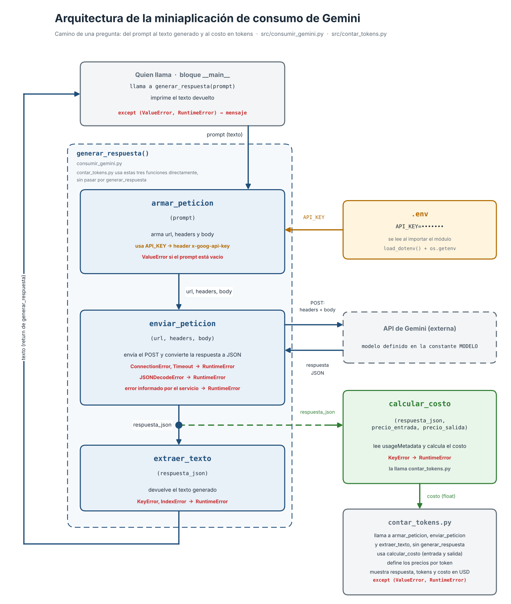

# Decisión de arquitectura: elección de modelo

Fecha: 24-10-2026

## Modelo elegido

Se eligió el modelo **gemini-3.1-flash-lite**, de la API de Gemini, como modelo de la miniaplicación generadora de esquemas de bases de datos. El modelo se define en la constante `MODELO` del archivo `src/consumir_gemini.py`.

## Diagrama de arquitectura

El diagrama representa el flujo de las funciones `armar_peticion`, `enviar_peticion` y `extraer_texto`, la ubicación de la credencial `API_KEY`, el manejo de errores y el cálculo del costo a partir de `usageMetadata`.

## Comparación de candidatos

La comparación se realizó el 24-10-2026. Los precios corresponden al nivel pagado y se expresan en USD por 1 millón de tokens. Se efectuaron 3 corridas de 4 repeticiones por modelo (12 intentos en total), con la misma pregunta de latencia en cada intento. Los datos originales se conservan en `docs/resultados_comparacion.json`.

| Criterio | gemini-3.5-flash-lite | gemini-3.1-flash-lite |
|---|---|---|
| Precio de entrada (USD por 1M tokens) | 0,30 | 0,25 |
| Precio de salida (USD por 1M tokens) | 2,50 | 1,50 |
| Tokens de salida por respuesta (última petición de cada corrida) | 93 a 123 | 68 a 74 |
| Costo promedio por petición (USD) | 0,000278 | 0,000124 |
| Latencia promedio observada (12 intentos) | 4,50 s | 4,84 s |
| Latencia mediana (12 intentos) | 5,32 s | 4,12 s |
| Rango de latencia | 2,15 a 7,00 s | 1,96 a 16,61 s |
| Calidad (promedio de 6 respuestas, escala de 1 a 5) | 4,5 | 4,5 |

Consideraciones sobre la medición:

- La latencia varió más entre corridas (de 2 a 6 s) que entre modelos, por lo que depende de la carga del servicio en cada momento. En cada corrida, el modelo 3.5 se midió antes que el 3.1.
- La calidad se evaluó mediante un puntaje asignado por el autor a 6 respuestas por modelo (3 corridas por 2 preguntas), conforme a cuatro criterios: entidades, relaciones, aspectos específicos solicitados y extensión. La muestra es reducida y el evaluador es único, por lo que el empate no constituye un resultado preciso.
- Las mediciones se realizaron con una versión previa de `src/comparar_modelos.py`, que repetía el proceso 3 veces. La versión incluida en el repositorio ejecuta una corrida de 4 repeticiones con la misma lógica de medición.

### Medición de calidad

La calidad se evaluó sobre dos preguntas representativas de la miniaplicación, definidas en `src/comparar_modelos.py`: la pregunta 1 trata de una pyme que vende ropa por internet, y la pregunta 2, de un almacén de barrio que une ventas e inventario. En cada corrida, la pregunta 1 se repitió cuatro veces para medir la latencia y se evaluó la respuesta de la última repetición; la pregunta 2 se planteó una vez. De este modo se evaluaron 6 respuestas por modelo, conservadas en `docs/resultados_comparacion.json`.

Criterios de evaluación:

| Criterio | Qué se revisa |
|---|---|
| Entidades | Propone las tablas que el caso necesita. |
| Relaciones | Explica cómo se relacionan las tablas (cardinalidad, tabla intermedia). |
| Aspectos específicos | Cubre lo que pide la pregunta. En la pregunta 2: manejo de precios y registro de entradas y salidas. |
| Extensión | Respeta el máximo de líneas indicado. |

Escala de puntaje:

| Puntaje | Significado |
|---|---|
| 5 | Completamente alineado: cumple los cuatro criterios sin debilidades. |
| 4 | Alineado con una debilidad menor. |
| 3 | Parcialmente alineado: una debilidad afecta un criterio. |
| 2 | Lejos de lo pedido: omite varios elementos. |
| 1 | Muy lejos de lo pedido. |

Puntajes asignados:

| Modelo | Pregunta | Corrida 1 | Corrida 2 | Corrida 3 | Promedio |
|---|---|---|---|---|---|
| gemini-3.5-flash-lite | 1 | 5 | 5 | 5 | 5,0 |
| gemini-3.5-flash-lite | 2 | 5 | 3 | 4 | 4,0 |
| gemini-3.1-flash-lite | 1 | 5 | 5 | 4 | 4,7 |
| gemini-3.1-flash-lite | 2 | 4 | 5 | 4 | 4,3 |

Observaciones que explican los puntajes menores a 5:

- 3.5, pregunta 2, corrida 2 (3): anuncia 4 tablas y agrega una quinta, y no congela el precio de venta en el detalle de la venta.
- 3.5, pregunta 2, corrida 3 (4): anuncia 4 tablas y agrega `Movimientos_Inventario`.
- 3.1, pregunta 1, corrida 3 (4): indica que Productos se relaciona directamente con Pedidos, cuando lo hace a través del detalle.
- 3.1, pregunta 2, corridas 1 y 3 (4): la tabla de movimientos o de compras no figura en la lista inicial de tablas.

## Justificación

Los criterios se ordenan desde el que mayor peso tuvo en la decisión hasta el que tuvo menor peso:

1. **Costo (mayor peso).** Fue la única diferencia estable entre ambos modelos: el 3.1 resultó 2,2 veces más económico por petición (US$ 0,000124 frente a US$ 0,000278). En un generador de esquemas de bases de datos, cada uso del sistema implica una llamada al modelo, por lo que esta diferencia se multiplica con el volumen de uso: con un millón de peticiones, el costo sería de aproximadamente US$ 124 frente a US$ 278.
2. **Latencia (peso intermedio).** La mediana del modelo 3.1 fue menor o igual que la del 3.5 en las tres corridas; sin embargo, la variación entre corridas fue mayor que la diferencia entre modelos. Además, el modelo 3.1 registró un valor máximo de 16,61 s en 1 de 12 intentos, y el módulo actual no incorpora reintentos. Se aceptó este riesgo por tratarse de un único dato en una muestra reducida, y porque puede acotarse en etapas posteriores mediante un reintento o un tiempo de espera menor.
3. **Calidad (menor peso).** Ambos modelos obtuvieron el mismo puntaje (4,5), por lo que este criterio no inclinó la decisión. Se consideró un umbral mínimo, que ambos modelos cumplen.

La decisión deberá revisarse si aumenta el volumen de uso, si la latencia máxima pasa a ser un requisito, o si una muestra mayor confirma los valores máximos observados.

## Alternativa descartada y por qué

- **gemini-3.5-flash-lite.** Presentó una latencia más regular (máximo de 7,00 s), pero su costo por petición fue 2,2 veces mayor y su calidad no resultó superior (4,5 en ambos modelos). Se descartó porque la regularidad observada no compensa el mayor costo en este proyecto.
- **gemini-3.8-flash.** Se descartó antes de la comparación formal. Durante las pruebas de medición se registraron 2 tiempos de espera agotados (60 s) y 1 error HTTP 503 por alta demanda, por lo que no fue posible completar su medición. Se trata de una observación puntual de dichas pruebas y no de una conclusión general sobre la disponibilidad del modelo.